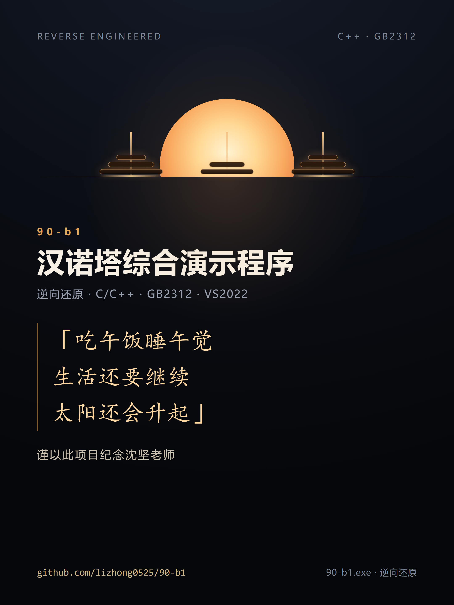

吃午饭睡午觉生活还要继续太阳还会升起

本项目根据90-b1.exe逆向生成

谨以此项目纪念沈坚老师


---

# 90-b1 汉诺塔综合演示程序（逆向还原）

## 项目简介

本项目是对 Windows 控制台程序 `90-b1.exe` 的完整逆向还原，输出可直接编译的 C/C++ 源代码。

原程序是一个**菜单驱动的汉诺塔综合演示程序**，通过控制台字符单元格模拟伪图形界面，逐字符绘制三根圆柱与圆盘，并带有上升、平移、下降的移动动画。

- 原程序：`90-b1.exe`（PE32 / x86 / 控制台子系统，MSVC Debug 编译，98,304 字节）
- 还原语言：**C/C++**
- 源码编码：**GB2312**
- 编译环境：Visual Studio 2022（x86 本机工具），Windows 控制台（新宋体 16 点阵，窗口 120×40）

## 功能（主菜单）

| 菜单项 | 功能 | 对应实现 |
|---|---|---|
| 1 | 基本解 | `hanoi_print_mode1` |
| 2 | 基本解（步数记录） | `hanoi_print_mode2` |
| 3 | 内部数组显示（横向） | `hanoi_print_mode3` / `hanoi_show_array` |
| 4 | 内部数组显示（纵向+横向） | `hanoi_move_mode4` / `hanoi_prepare` |
| 5 | 图形解-预备-画三个圆柱 | `hanoi_draw_cylinders` |
| 6 | 图形解-预备-在起始柱上画 n 个盘子 | `hanoi_draw_column` |
| 7 | 图形解-预备-第一次移动 | `hanoi_first_move` |
| 8 | 图形解-自动移动版本 | `hanoi_move_mode8` / `hanoi_animate` |
| 9 | 图形解-游戏版 | `hanoi_game` |
| 0 | 退出 | `main` |

所有菜单项共用唯一的递归函数 `hanoi`、共用的多参数输入函数 `hanoi_input_params`，
以及共用的横向/纵向数组输出、画柱与移动动画函数。

## 文件结构

```
hanoi_main.cpp                main 函数与各菜单项分派
hanoi_menu.cpp                菜单显示与按键读取
hanoi_multiple_solutions.cpp  输入函数、递归求解、数组显示、图形解、游戏版
hanoi.h                       全局变量与函数声明
hanoi_const_value.h           窗口尺寸、坐标、颜色、延时等常量
cmd_console_tools.h/.cpp      控制台工具函数（cct_*）
cmd_hdc_tools.h/.cpp          伪图形界面基本函数（hdc_*）
build.bat                     编译脚本（VS2022 x86）
README.txt                    工程说明（GB2312）
VERIFY.txt                    验证记录（GB2312）
逆向分析报告.txt               逆向分析方法与函数地址对照表（GB2312）
rebuilt.exe                   还原源码的编译产物
```

## 编译

在 Visual Studio 2022 的 x86 开发者命令提示符中运行：

```bat
build.bat
```

或手动执行：

```bat
cl /nologo /EHsc /Zi /MDd /D_DEBUG /Fe:rebuilt.exe ^
   hanoi_main.cpp hanoi_menu.cpp hanoi_multiple_solutions.cpp ^
   cmd_console_tools.cpp cmd_hdc_tools.cpp
```

## 验证

使用控制台自动化驱动（CreateProcess + AttachConsole + 注入按键事件 +
读取屏幕缓冲区字符与颜色属性），对原程序与还原程序在相同输入下逐格比较：
**字符内容、颜色属性、光标位置全部一致（0 差异）**。

已验证场景包括主菜单、菜单项 1–9（不同层数与起止柱、动画向左/向右移动）、
游戏版（正常胜利、源柱为空、大盘压小盘、退出）、输入校验以及退出程序等。
详细信息见 `VERIFY.txt`。

## 关于编码

本仓库根目录中的 `.cpp` / `.h` / `.txt` 文件均使用 **GB2312** 编码（按课程要求）。

为便于在 GitHub 网页上直接阅读，`utf8/` 目录提供了全部源码与文档的 UTF-8 阅读副本；
参与编译与使用的仍是根目录下的 GB2312 源文件。

在 GitHub 网页上直接查看 GB2312 文件时中文可能显示为乱码，建议：

- 下载后用支持 GB2312 的编辑器打开（如 VS Code 设置 `files.encoding` 为 `gb2312`）；
- 或转换为 UTF-8 后阅读：

```bash
iconv -f GB2312 -t UTF-8 hanoi_multiple_solutions.cpp > hanoi_multiple_solutions.utf8.cpp
```

## 逆向说明

- 通过 PE 解析、字符串提取（GB2312）、objdump 反汇编、Ghidra 反编译与
  自建控制台驱动逐格比对完成还原。
- 原程序为 Debug 版，函数边界与局部变量清晰可辨；函数名与变量名为按功能推断，
  不影响程序行为。
- 二进制中未被汉诺塔逻辑调用的库函数也一并按行为重建，保证内容完整。
- 更详细的函数地址对照表与数据结构说明见 `逆向分析报告.txt`（GB2312）。


## 分享卡片



- 分享卡片（竖版 1080×1440）：`images/share-card.png`
- 社交预览图（横版 1280×640）：`images/social-preview.png`
- 卡片源文件（HTML/CSS，可改字改色后重新截图）：`images/card-poster.html`、`images/card-og.html`
